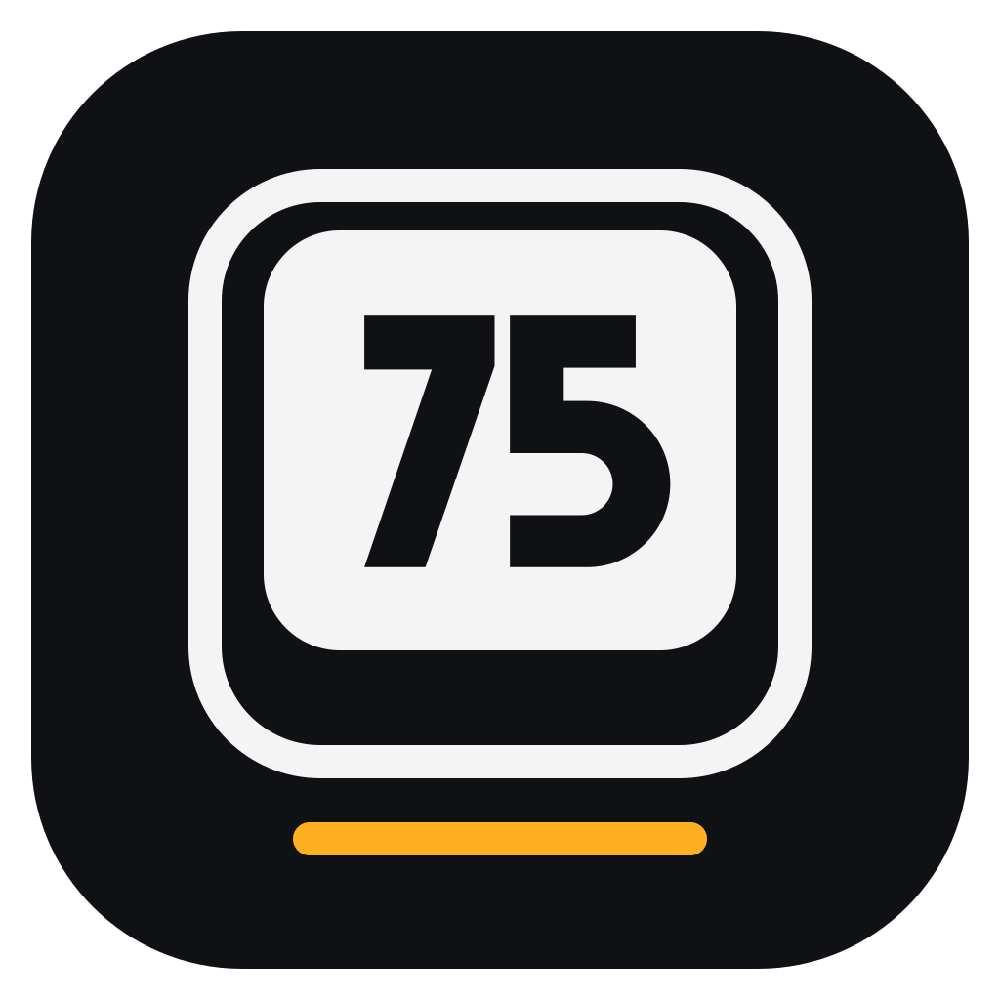

<p align="center">
  
</p>

<h1 align="center">Lumen75</h1>

An unofficial desktop app for the **AULA F75** keyboard. You can use it instead of the official
software for lighting, per-key colours, key remapping, macros and device settings. It adds a
few things the official app can't do: animations in your own colours, lighting that follows your
music, and lighting that reacts to League of Legends matches.

Windows only for now. Built with Tauri 2, Rust, React, TypeScript and shadcn/ui.

> Close the official AULA app before using Lumen75. Both talk to the keyboard over the same
> channel, and Lumen75 warns you when the official app is running.

## Connections

The F75 has a switch on the back for three connections. Lumen75 supports all three. Pick one in
the app's header, or leave it on **Auto** (it tries the cable first). Your choice is saved.

| Connection | ID | Notes |
| --- | --- | --- |
| 2.4G dongle | `3554:FA09` | The most tested connection. Everything works. |
| Bluetooth | `3554:FA07` (LE), `3554:FA08` (classic) | Pair **"AULA-F75 5.0"** in Windows Bluetooth settings. Reading the keyboard is slow (about 2 minutes for everything), because many reply packets get lost over Bluetooth. |
| USB cable | `258A:010C` | Uses a different protocol. Lighting, device settings and streamed effects work. The rest isn't worked out yet. |

## Features

✅ works, tested on the keyboard · 🧪 built, not tested yet · ⚠️ works, with limits ·
❌ not available yet · — doesn't apply

| Feature | What it does | 2.4G | Bluetooth | Cable |
| --- | --- | :-: | :-: | :-: |
| **Lighting effects** | The 16 built-in effects, with brightness (0-9), speed (0-4) and colour | ✅ | 🧪 | ✅ |
| **Custom colours** | Any RGB colour for an effect, and factory colours back with one click | ✅ | 🧪 | ❌ |
| **Per-key colours** | Paint keys on a drawn keyboard (with groups like WASD, arrows and F-keys), and save layouts as presets | ✅ | 🧪 | ❌ |
| **Key remapping** | Remap any key on the base or Fn layer to a key, a combo, a modifier or a macro, disable it, or reset it. Every change is read back and checked | ✅ | 🧪 | ❌ |
| **Macros** | Steps like `text:Hello`, `ctrl+c`, `wait:100`, stored on the keyboard. Run N times, while held, or until a key is pressed. Text is typed for your layout (US or Turkish Q) | ✅ | 🧪 | ❌ |
| **Animations** | Stream, Breathing, Wave, Sparkle and Gradient in your own colours (1-7), with speed, brightness, direction and presets | ✅ | 🧪 | ✅ |
| **Audio lighting** | The lights follow whatever your PC plays (Spectrum, Mirror, Ripple, Pulse), with gain, smoothness, rainbow or your own colours, presets and a choice of output device. No microphone needed | ✅ | 🧪 | ✅ |
| **League of Legends lighting** | During a match: bars for health, mana, gold, level and respawn, a dead state, and effects for kills, objectives and the result. All customisable, with presets | 🧪 | — | 🧪 |
| **Device settings** | Side light, knob mode, OS mode, Windows-key lock and sleep timer | ✅ | 🧪 | ✅ |
| **Battery level** | Shown in the header | ⚠️ | ⚠️ | — |
| **Backup and restore** | Saves and restores everything as hex files, compatible with `aula backup` / `aula restore` from aula-f75-hub | ✅ | ⚠️ | ❌ |
| **Tray and Start with Windows** | Closing the window keeps the app in the tray (Open, Animation on/off, Quit). Starts hidden with Windows and resumes your last animation | ✅ | ✅ | ✅ |

Notes:

- **Animations, audio and League lighting stream from the app.** Nothing is stored on the
  keyboard, so they only run while Lumen75 is running (also from the tray). About 2 seconds
  after the app stops, the keyboard goes back to its own effect. About 14 frames a second get
  through over 2.4G, and about 11 over Bluetooth. Animations pause when the PC is idle, so the
  keyboard can sleep.
- **Why stream at all?** The F75's own multicolour effects use a fixed rainbow and ignore the
  colour palettes (tested). Streaming is the only way to get animations in your own colours.
- **Battery** is experimental: it's the first byte of the keyboard's status reply, and it read
  100 at full charge. It hasn't been checked at lower charge.
- **Backup over Bluetooth** works but takes a few minutes, for the slow reads.
- **League lighting** uses only the match data League itself shares on your PC (Riot's Live
  Client Data API). It doesn't read the game's memory or touch the game itself. It
  can't show cooldowns, because League doesn't share them. It doesn't run over Bluetooth, which
  is too slow for it. After a match it brings back your animation or audio lighting.

## AULA S75 Pro (new, untested)

Lumen75 also supports the **AULA S75 Pro**, built from the protocol notes of
[open-aula](https://github.com/paulcoding810/open-aula). It hasn't been tried on an S75 Pro
yet: if you have one, please report what works. When an S75 Pro is connected (and no F75),
the app switches to its pages.

| Feature | What it does | USB cable | 2.4G dongle |
| --- | --- | :-: | :-: |
| **Lighting effects** | Its 19 effects with colour, rainbow, brightness (0-5), speed (0-5) and direction, plus the side light bar | 🧪 | 🧪 |
| **Per-key colours** | Paint keys and apply; read the stored colours back | 🧪 | 🧪 (no read-back) |
| **Key remapping** | Base and Fn layers: keys and combos, media keys, mouse actions, macros, disable | 🧪 | 🧪 |
| **Macros** | Up to 100, typed one step per line (`ctrl+c`, `wait 100`, `text Hello`, `click left`) | 🧪 | 🧪 |
| **Screen** | A GIF or picture on its 135 × 240 screen, with a preview | 🧪 | — |
| **Clock** | Set it to the PC's time | 🧪 | 🧪 |
| **Settings** | Win, Alt+F4 and Alt+Tab locks, Fn layer mode, sleep, debounce | 🧪 | 🧪 |
| **Battery** | Shown on the Device page | — | 🧪 |

Two things differ from the F75:

- **No streamed lighting.** The S75 Pro's real-time colour command isn't known yet, so
  Animations, Audio, Games and Discord don't work on it.
- **Settings can't be read back** (except per-key colours over USB), so the S75 Pro pages show
  what Lumen75 last set.

## Possible next features

These are possible with what's known about the keyboard, but not built yet.

| Feature | What it would do | What it needs |
| --- | --- | --- |
| **Full cable support** | Custom colours, per-key colours, key remapping and macros over the USB cable | Finding the cable's write commands for those tables. The read commands are already known |
| **Faster Bluetooth** | Read the keyboard in seconds instead of minutes | A smarter way to ask for only the missing packets |
| **Typing effects** | Keys light up as you press them, with ripples or fading trails | Watching key presses on the PC and streaming frames. Possible now |
| **Screen ambience** | The keyboard takes the colours of your screen, like an ambient TV light | Screen capture, then the same streaming as audio lighting |
| **Per-app profiles** | Switch lighting automatically when a game or app comes to the front | Watching the focused window. Possible now |
| **More games** | Lighting for CS2 and Dota 2 | Valve's Game State Integration, which works like League's local data |
| **Status lights** | Light a key for Caps Lock, a muted microphone or a new notification | Reading those states on Windows, on top of other lighting |
| **Low-battery alert** | A notification before the keyboard runs out | Confirming the battery reading at low charge first |
| **Other AULA keyboards** | Support for the F87, F99 and others (the S75 Pro is in, untested) | Captures from those keyboards, or notes like open-aula's |
| **Linux and macOS** | Lumen75 on other systems | A HID backend for each. The rest of the app is cross-platform |

Not planned: firmware updates. Flashing the wrong firmware can brick the keyboard.

## How it works

The Rust side (`src-tauri/src/`):

- `protocol.rs`: the wireless packets (20-byte report `0x13`, 14-byte chunks, checksum), the
  wired 520-byte feature reports, the 128-byte lighting and settings block, palettes, the
  per-key table and keymap entries.
- `device.rs`: reads (reassembled by packet index, with retries) and writes (each packet is
  echoed back as an acknowledgement, with retries), with a pause after writes. Over the cable,
  each write is read back to check it.
- `win.rs`: finds the keyboard on each connection, does the Windows HID input and output, and
  only talks to the keyboard while no key is held. Otherwise the keyboard can drop a key
  release.
- `audio.rs`: captures the PC's sound (WASAPI loopback), splits it into frequency bands with
  automatic levels, and turns them into frames.
- `anim.rs`: the animations as functions of time, and the streaming thread with idle pause.
- `league.rs`, `gamelight.rs`, `match_watch.rs`: League's local match data, the game lighting,
  and when to take over the keyboard and hand it back.
- `app.rs`: saved settings and presets, tray, Start with Windows, single instance.
- `s75/`: the AULA S75 Pro: its protocol, key layout, connection (USB and dongle), screen
  images and the app's commands for it.
- `macros.rs`, `keymap.rs`: the macro format, the step parser, the key layout and HID usages.

The React side is in `src/`, with one file per page in `src/pages/`.

## Develop

You need Node.js, Rust and the Visual Studio C++ build tools.

```bash
npm install
npm run tauri dev
```

Run the tests:

```bash
cd src-tauri && cargo test
```

The tests check packets against values captured from a real keyboard, round-trip the factory
macro byte for byte, parse a real backup, and run sample League match data through the game lighting.

Build the installers (an MSI and an NSIS setup, in `src-tauri/target/release/bundle/`):

```bash
npm run tauri build
```

The app icon is `app-icon.svg`. Regenerate every size with `npx tauri icon app-icon.svg`. The
tray uses `tray-icon.svg`, a simpler version that stays readable at 16-24 px, rendered to
`src-tauri/icons/tray.png` and `tray@2x.png`.

## Credits

The protocol, effect numbers, key layout and macro format come from
[aula-f75-hub](https://github.com/bakiakyol/aula-f75-hub) by Baki Akyol (MIT). Its Python code
is ported to Rust here, and its factory table dumps are bundled in `src-tauri/factory/`. The
wired real-time header follows
[aula-f75-linux-drivers](https://github.com/cloudglides/aula-f75-linux-drivers). Details are in
[THIRD_PARTY_NOTICES.md](THIRD_PARTY_NOTICES.md).

Built with AI assistance (Claude), then tested by hand on a real F75.

## Licence

MIT, see [LICENSE](LICENSE). The parts from aula-f75-hub stay under its MIT licence.

## Disclaimer

This is an unofficial, independent project. It isn't affiliated with, endorsed by or
supported by AULA. AULA and F75 are trademarks of their owner and are used here only to say
which keyboard this app works with. Use it at your own risk: it writes to the keyboard's
settings, so make a backup first (Device → Backup).

Lumen75 isn't endorsed by Riot Games and doesn't reflect the views or opinions of Riot Games
or anyone officially involved in producing or managing Riot Games properties. Riot Games, and
all associated properties are trademarks or registered trademarks of Riot Games, Inc.
